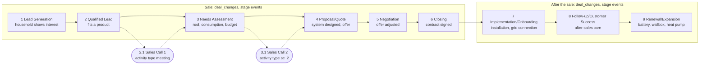

---
tags:
  - project/enpal
  - type/assumption
---
# Business context and the funnel

The business context of the task and **my assumption** of how a deal goes through Enpal's sale, built from the company description, the CRM data and the Pipedrive vocabulary. It is not confirmed by Enpal and has to be checked with the KPI owner (head of sales or revenue operations), see [[02_approach]]. Fields: [[03_data_dictionary]]; entities and relationships: [[06_logical_model]].

## The company

From the company description provided with the task: Enpal is a Berlin-based energy company that sells residential and commercial energy solutions (PV systems, battery storage, EV wallboxes, heat pumps, smart meters, energy management) with zero-upfront-cost rental or purchase options. It serves over 115,000 customers; Enpal Energy is its electricity division.

## The sale behind the data

Selling a solar system to a household is a long, consultative sale: a lead shows interest, a sales rep qualifies it, consultation calls follow, the roof, consumption and budget are assessed, a system is designed and offered (rental or purchase), the offer is negotiated and signed, then the system is installed and connected, and after-sales follows (service, add-ons such as storage, a wallbox, a heat pump or an electricity contract).

Pipedrive, the CRM in the export, records this as **deals** moving through the **stages** of a **pipeline**, owned by **users** (sales staff), with **activities** (calls, meetings) planned against them. There is no deals table: a deal exists only as the `deal_id` of its change events.

Solid arrows: stage events in `deal_changes` (each deal counts once per stage it reached). Dotted: consultation calls from `activity`, which in this export cannot be linked to the deals (only 8 of 4,579 deal ids match).

## The funnel: each KPI, its business meaning and how it is counted

The step names are the task's. The business meaning is **my interpretation, to confirm with Enpal**; the rule is what `rep_sales_funnel_monthly` implements. Following the task's suggestion to research the Pipedrive terms, the month follows Pipedrive's [deal conversion report](https://support.pipedrive.com/en/article/insights-reports-deal-conversion), which filters on the deal creation date: every stage step counts the deals created in the month (cohort) that reached the stage at any time.

| Step | KPI | Business meaning (interpretation) | Data | Rule in the report |
|---|---|---|---|---|
| 1 | Lead Generation | a household shows interest and enters the pipeline | `deal_changes` | deals created in the month that reached stage 1 |
| 2 | Qualified Lead | the lead fits a product and is worth a consultation | `deal_changes` | deals created in the month that reached stage 2 |
| 2.1 | Sales Call 1 | first consultation call | `activity` | deal ids with a done activity of type `meeting`, by due month (no link to the deals, A2) |
| 3 | Needs Assessment | roof, consumption and budget assessed | `deal_changes` | deals created in the month that reached stage 3 |
| 3.1 | Sales Call 2 | second consultation call | `activity` | deal ids with a done activity of type `sc_2`, by due month (no link to the deals, A2) |
| 4 | Proposal/Quote Preparation | system designed, offer (rental or purchase) prepared | `deal_changes` | deals created in the month that reached stage 4 |
| 5 | Negotiation | offer discussed and adjusted | `deal_changes` | deals created in the month that reached stage 5 |
| 6 | Closing | contract signed | `deal_changes` | deals created in the month that reached stage 6 |
| 7 | Implementation/Onboarding | installation and grid connection | `deal_changes` | deals created in the month that reached stage 7 |
| 8 | Follow-up/Customer Success | after-sales care | `deal_changes` | deals created in the month that reached stage 8 |
| 9 | Renewal/Expansion | add-ons: storage, wallbox, heat pump, electricity | `deal_changes` | deals created in the month that reached stage 9 |

Skipped stages count as reached; Duplicate Entry deals are left out. These are assumptions, see [[05_data_quality_issues_and_assumptions]]. Not funnel steps: the activity types Follow Up Call and After Close Call.

## What the business would expect, and what the data shows

| Expectation from the business | What the data shows | Consequence for the report |
|---|---|---|
| A lead is created, assigned to a rep, then enters the pipeline | Every deal: created, then an owner ~15 days later (always before stage 1), then stage 1 a median 35 days after creation | Every step of a deal counts in its creation month (cohort), as in Pipedrive (assumption) |
| Deals pass every stage in order | 84% of deals skip at least one stage; 683 of 1,081 deals in stages 7 to 9 never recorded Closing | Skipped stages could count as reached, flagged `is_inferred` (assumption) |
| A funnel narrows sharply from step to step | It barely narrows: only 5 deals stop at stage 1, 324 reach stage 9 | Reported as is |
| Sales Call 1 happens around Qualified Lead, Sales Call 2 around Needs Assessment | Calls are flat at ~130 per type per month from January, when almost no deal had reached stage 2 or 3; they end 2024-09-13 while stage events run to 2025-02 | Steps 2.1 and 3.1 count calls by due month, not by cohort |
| A call is linked to a deal in the funnel | 8 of 4,579 activity rows match a deal id | Calls are not tied to the funnel deals |
| Calls in the past are mostly done | Every type is 50% done, although all calls are due before the export ends | Done calls only (assumption): it halves steps 2.1 and 3.1; the calls due before the export ended are flagged, in case Enpal confirms that they count |
| A lost reason means the deal was lost | Every deal has one, also the 324 deals that reached Renewal/Expansion | Lost reason read as a closure label, not an outcome; a win/loss analysis does not seem possible |
| A duplicate lead is merged early | 377 deals are lost as Duplicate Entry; 274 of them reached Closing | Duplicate Entry deals left out of the funnel (assumption) |
| A sales rep owns many deals | 1,347 owners for 1,995 deals (median 2 each) | Owner is not needed for the report |

## What the export cannot answer

Deal status (open, won, lost), value, product, person and organisation, the pipeline id, who made a change, the previous value of a field, and when an activity was completed. Win rates, revenue and product mix are out of reach.

## Size

1,995 deals and 4,579 activities against more than 115,000 customers: a sample, not Enpal's scale. Read the structure and the data quality from it, not the business volume or conversion rates.
