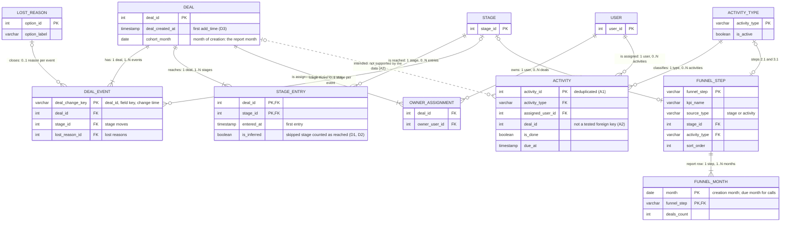

---
tags:
  - project/enpal
  - type/model
---

# Logical model

The business entities behind the six raw tables and how they relate. The dbt layers (staging, intermediate, marts) implement this model. The diagram is maintained by hand and follows the dbt models as built: each model names its entity in `meta.logical_entity` (table under the diagram), and the solid lines are tested with relationships tests or, on the marts, declared as key constraints. Each relationship shows its **cardinality** (the maximum number of related instances: one or many) and its **ordinality** (the minimum: zero or one) in crow's foot notation; the counts in the labels were measured on the loaded data. A dotted line marks a relationship the business expects but the export does not support.

## Notation

| End of the line | Meaning | Mermaid (left end / right end) |
|---|---|---|
| ─┼ | One | drawn as one and only one: `\|\|` / `\|\|` |
| ─< | Many | drawn with its minimum: `}o` / `o{` or `}\|` / `\|{` |
| ─┼┼ | One (and only one) | `\|\|` / `\|\|` |
| ─○┼ | Zero or one | `\|o` / `o\|` |
| ─┼< | One or many | `}\|` / `\|{` |
| ─○< | Zero or many | `}o` / `o{` |

Read a line from one entity to the other: the symbol at the far end says how many instances of the far entity one instance of the near entity has. Example: `DEAL ||--|{ DEAL_EVENT`: one deal has one or many events; one event belongs to one and only one deal. Mermaid always draws the minimum, so a plain "One" or "Many" is shown with its ordinality.

| Entity | dbt models |
|---|---|
| DEAL | `int_pipedrive__deal_cohorts` |
| DEAL_EVENT, OWNER_ASSIGNMENT | `stg_pipedrive__deal_changes` (owner changes are its `user_id` rows) |
| STAGE_ENTRY | `int_pipedrive__deal_stage_entries` (recorded), `int_pipedrive__deal_stage_entries_backfilled` (with inferred stages) |
| STAGE | `stg_pipedrive__stages` |
| LOST_REASON | `stg_pipedrive__field_options` (field `lost_reason`) |
| USER | `stg_pipedrive__users` |
| ACTIVITY | `stg_pipedrive__activity`, `int_pipedrive__sales_calls` (the two call types) |
| ACTIVITY_TYPE | `stg_pipedrive__activity_types` |
| FUNNEL_STEP | `int_pipedrive__funnel_steps`, `dim_funnel_step` |
| FUNNEL_MONTH | `rep_sales_funnel_monthly` |

## Relationships

Cardinality and ordinality read from the first entity to the second, then back.

| Relationship | First → second | Second → first | Measured | Consequence for the model |
|---|---|---|---|---|
| Deal : deal event | one or many | one and only one | 4 to 17 events per deal | There is no deals table: one row per deal with its first creation and cohort month is derived (`int_pipedrive__deal_cohorts`) |
| Deal field : deal event | zero or many | one and only one | 4 keys, all used | Typed per-key columns in staging (stage, owner, creation, lost reason) |
| Deal field : field option | zero or many | one and only one | `stage_id` 9 options, `lost_reason` 5, the others none | Options unpacked from JSON in staging |
| Deal : stage entry | one or many | one and only one | 1 to 8 stages per deal (no deal enters all 9) | Grain deal x stage, one row per stage reached; the backfill adds inferred entries (D1, D2) |
| Stage : stage entry | zero or many | one and only one | 324 to 1,995 deals per stage | `relationships` test from the stage moves to the stages |
| Stage : field option | one and only one | zero or one | 9 labels, one spelled differently (S1) | Step names from the field labels |
| Deal : owner assignment | one or many | one and only one | 1 to 3 per deal | Owner over time needs the events; `users` is current state |
| User : owner assignment | zero or many | one and only one | 1,347 owners, 1 to 7 deals each | Not needed for the report |
| Lost reason : deal | zero or many | zero or one per lifecycle | 377 to 422 deals per reason; every deal has one, 5 deals carry 2 (D3) | A closure label, not an outcome (D4); Duplicate Entry deals leave the funnel (DUP-6) |
| Lost reason : field option | one and only one | zero or one | 5 reasons | Labels from the field options |
| Activity type : activity | zero or many | one and only one | 1,124 to 1,177 per type | Join on the key string `type` |
| User : activity | zero or many | one and only one | 1 to 11 per user | `relationships` test |
| Deal : activity | zero or many (intended) | zero or one | 8 of 4,579 match (A2) | Calls counted by due month, not per funnel deal or cohort (A2) |
| Funnel step : stage | zero or one | one and only one | 9 stage steps | `int_pipedrive__funnel_steps` with `source_type` |
| Funnel step : activity type | zero or one | zero or one | 2 call steps; Follow Up and After Close Call are none | `int_pipedrive__funnel_steps` with `source_type` |
| Funnel step : funnel month | one or many | one and only one | one row per month and step, zero-filled | Report grain (`month`, `funnel_step`); month = the deals' creation month for stage steps, the due month for call steps |

## Assumptions reflected in the model

The model carries the default handling of the data quality issues ([[05_data_quality_issues_and_assumptions]]); each could change once the stakeholders confirm or reject it.

| Assumption | Where in the model |
|---|---|
| A deal belongs to the month it was created in (cohort), as in Pipedrive's deal conversion report | `DEAL.cohort_month` (`int_pipedrive__deal_cohorts`), used as `FUNNEL_MONTH.month` for stage steps |
| A deal with two lifecycles is one deal, counted once per stage, in the month of its first creation (D3) | `DEAL` (first `add_time`), `STAGE_ENTRY` (first entry) |
| A skipped stage counts as reached (D1, D2) | `STAGE_ENTRY.is_inferred` |
| Duplicate Entry deals leave the funnel (DUP-6) | filtered in staging, before `DEAL` |
| Calls cannot be linked to the funnel deals (A2) and count only when done (A4) | `DEAL : ACTIVITY` stays dotted; call steps by due month |
| The lost reason is a closure label, not an outcome (D4) | `LOST_REASON` is not used in the report |
