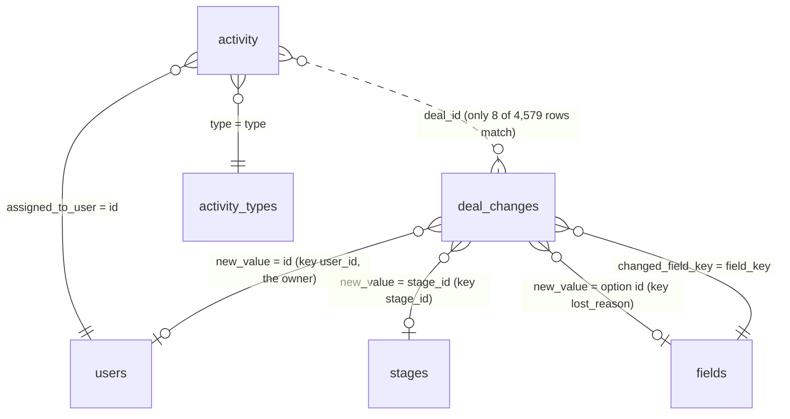

# Business context

The one place for the business context of the task. The analysis files in `analyses/` refer here instead of repeating it. Field definitions with links to the Pipedrive documentation are in `vault/project/data_dictionary.md`; the assignment is in `vault/project/task.md`.

## The company

From the company description provided with the task: Enpal is a Berlin-based energy company that sells residential and commercial energy solutions (PV systems, battery storage, EV wallboxes, heat pumps, smart meters, energy management) with zero-upfront-cost rental or purchase options. It serves over 115,000 customers; Enpal Energy is its electricity division.

The role (Senior Analytics Engineer) asks for governed metric definitions, a semantic layer and machine-readable documentation that AI analytics tools can use as context. So every KPI below needs one written definition, and every field one description.

## The sale and the funnel

My assumption of how a deal goes through Enpal's sale, the funnel diagram and the KPI-to-data map are in `vault/project/sales_funnel_assumptions.md`.

## How the tables relate

There is no deals table: a deal exists only as the `deal_id` of its change events.

| Table | Business object | Class |
|---|---|---|
| `deal_changes` | the history of each deal: created, owner assigned, stage entered, lost reason set | fact (event log) |
| `activity` | calls and meetings planned for a user and a deal | fact |
| `stages` | the nine pipeline stages | dictionary |
| `activity_types` | the four kinds of activity | dictionary |
| `users` | sales staff (current state only) | dictionary, master data |
| `fields` | the deal fields and their option lists (stage labels, lost reasons) | dictionary, metadata |

Each relationship of the diagram, with its type and the cardinality measured on the loaded data. Read "1 to many" as: one row on the "1" side, many rows on the other. The entity view of the same relationships (deal, stage entry, owner assignment) is in [[logical_model]].

| Relationship (join) | Type | Diagram | Measured |
|---|---|---|---|
| deal : `deal_changes` (`deal_id`) | 1 to many | not drawn: no deals table | every deal has 4 to 17 events |
| `fields` : `deal_changes` (`field_key` = `changed_field_key`) | 1 to many; each event has exactly 1 field | `}o--\|\|` | 4 fields, 2,000 to 8,906 events each; every event matches |
| `stages` : `deal_changes` stage events (`stage_id` = `new_value`, key `stage_id`) | 1 to many; only stage events have a stage (0 or 1 per event) | `}o--o\|` | 9 stages, 325 to 2,000 stage events each; no stage unused |
| `users` : `deal_changes` owner events (`id` = `new_value`, key `user_id`) | 1 to many, optional on the user side | `}o--o\|` | 1,347 owners, 1 to 7 owner events each; 440 users never own a deal; every owner id exists |
| `fields` lost-reason options : `deal_changes` lost-reason events (option id = `new_value`) | 1 to many | `}o--o\|` | 5 reasons, 377 to 423 events each |
| `fields` : its options (`field_value_options`) | 1 to many, optional (2 of 4 fields have options) | not drawn | `stage_id`: 9 options, `lost_reason`: 5 |
| `stages` : stage options in `fields` (`stage_id` = option id) | 1 to 1 | not drawn | 9 to 9; one label spelled differently ("Qualified lead" vs "Qualified Lead") |
| `activity_types` : `activity` (`type` = `type`) | 1 to many; each activity has exactly 1 type | `}o--\|\|` | 4 types, 1,124 to 1,177 activities each |
| `users` : `activity` (`id` = `assigned_to_user`) | 1 to many, optional on the user side | `}o--\|\|` | 1,650 users with 1 to 11 activities; 137 users with none; every assignee exists |
| deal : `activity` (`deal_id`) | intended 1 to many; **not supported** by the data | `}o..o{` (dotted: not enforced) | 8 of 4,579 activities match a deal |

## What the business would expect, and what the data shows

Each row is a business expectation tested in `analyses/08_business_questions.sql` (local only; section in brackets).

| Expectation from the business | What the data shows | Consequence for the report |
|---|---|---|
| A lead is created, assigned to a rep, then enters the pipeline (B1) | Every deal: created, then an owner ~15 days later (always before stage 1), then stage 1 a median 35 days after creation | Step 1 by creation and by stage 1 entry are different months (2024-01: 247 created, 30 entered stage 1). Open decision |
| Deals pass every stage in order (B2) | 84% of deals skip at least one stage | Backfill skipped stages with `is_inferred` (decided) |
| A funnel narrows sharply from step to step (B2) | It barely narrows: only 5 deals stop at stage 1, 324 reach stage 9, the most common last stage is 8 | Report as is; note that the sample looks pre-filtered or generated |
| A sale takes weeks to months (B3) | Stage 1 to Closing: median 50 days (IQR 35 to 66) | Plausible for a household energy sale |
| Sales Call 1 happens around Qualified Lead, Sales Call 2 around Needs Assessment (B4) | Calls are flat at ~130 per type per month from January, when almost no deal had reached stage 2 or 3; they end 2024-09-13 while stage events run to 2025-02 | Calls cannot be tied to the funnel deals; steps 2.1 and 3.1 count calls by due month, zero from 2024-10 |
| A call is linked to a deal in the funnel (B4) | 8 of 4,579 activity rows match a deal id; for those 8 the call dates do not fit the deal's stage dates, except one | The match is coincidence; question for the CRM admin |
| Calls in the past are mostly done (B4) | Every type is 50% done, although all calls are due before the export ends | Done-only vs all scheduled changes steps 2.1 and 3.1 by half. Open decision |
| A lost reason means the deal was lost (B5) | Every deal has one, 1 to 30 days after its last stage event, including 324 deals that reached Renewal/Expansion; the five reasons are spread evenly over all stages | Lost reason is a closure label, not an outcome; it does not remove deals from the funnel |
| A duplicate lead is merged early (B5) | 377 deals are lost as Duplicate Entry; 274 of them reached Closing | Question for the CRM admin |
| A sales rep owns many deals (B6) | 1,347 owners for 1,995 deals (median 2 deals each); 505 owner changes, 499 of them before stage 1 | Owner is not needed for the report; the user data looks generated |

## What the export cannot answer

Deal status (open, won, lost), value, product, person and organisation, the pipeline id, who made a change, the previous value of a field, and when an activity was completed. Win rates, revenue and product mix are out of reach.

## Size

1,995 deals and 4,579 activities against more than 115,000 customers: a sample, not Enpal's scale. Read the structure and the data quality from it, not the business volume or conversion rates.
