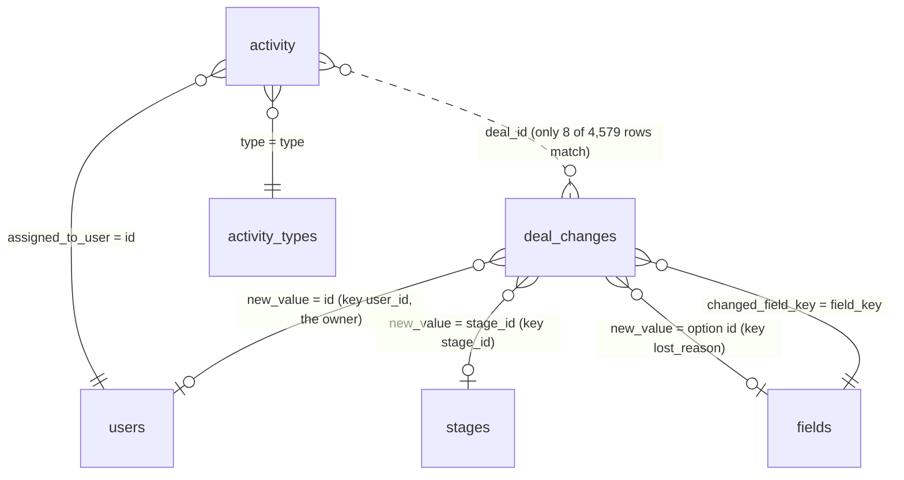

# Business context

The one place for the business context of the task. The analysis files in `analyses/` refer here instead of repeating it. Field definitions with links to the Pipedrive documentation are in `vault/project/data_dictionary.md`; the assignment is in `vault/project/task.md`.

## The company

From the company description provided with the task: Enpal is a Berlin-based energy company that sells residential and commercial energy solutions (PV systems, battery storage, EV wallboxes, heat pumps, smart meters, energy management) with zero-upfront-cost rental or purchase options. It serves over 115,000 customers; Enpal Energy is its electricity division.

The role (Senior Analytics Engineer) asks for governed metric definitions, a semantic layer and machine-readable documentation that AI analytics tools can use as context. So every KPI below needs one written definition, and every field one description.

## The sale behind the data

Selling a solar system to a household is a long, consultative sale: a lead shows interest, a sales rep qualifies it, consultation calls follow, the roof, consumption and budget are assessed, a system is designed and offered (rental or purchase), the offer is negotiated and signed, then the system is installed and connected, and after-sales follows (service, add-ons such as storage, a wallbox, a heat pump or an electricity contract).

Pipedrive, the CRM in the export, records this as **deals** moving through the **stages** of a **pipeline**, owned by **users** (sales staff), with **activities** (calls, meetings) planned against them. Pipedrive terms are explained in `vault/project/findings.md` (Pipedrive terms) and the Obsidian note `pipedrive_crm_terms`.

## The funnel: each KPI, its business meaning and where it is in the data

The step names are the task's. The business meaning is **my interpretation, to confirm with Enpal**.

| Step | KPI | Business meaning (interpretation) | Data | Candidate rule |
|---|---|---|---|---|
| 1 | Lead Generation | a household shows interest; a deal is created | `deal_changes` | creation (`add_time` event) **or** first entry into stage 1 (open decision) |
| 2 | Qualified Lead | the lead fits a product and is worth a consultation | `deal_changes`, `stages` | first entry into stage 2 |
| 2.1 | Sales Call 1 | first consultation call | `activity`, `activity_types` | activity type `meeting` (name Sales Call 1), done |
| 3 | Needs Assessment | roof, consumption and budget assessed | `deal_changes` | first entry into stage 3 |
| 3.1 | Sales Call 2 | second consultation call | `activity` | activity type `sc_2` (Sales Call 2), done |
| 4 | Proposal/Quote Preparation | system designed, offer (rental or purchase) prepared | `deal_changes` | first entry into stage 4 |
| 5 | Negotiation | offer discussed and adjusted | `deal_changes` | first entry into stage 5 |
| 6 | Closing | contract signed | `deal_changes` | first entry into stage 6 |
| 7 | Implementation/Onboarding | installation and grid connection | `deal_changes` | first entry into stage 7 |
| 8 | Follow-up/Customer Success | after-sales care | `deal_changes` | first entry into stage 8 |
| 9 | Renewal/Expansion | add-ons: storage, wallbox, heat pump, electricity | `deal_changes` | first entry into stage 9 |

Not funnel steps: the activity types Follow Up Call and After Close Call.

## How the tables relate

There is no deals table: a deal exists only as the `deal_id` of its change events.

| Table | Business object | Class |
|---|---|---|
| `deal_changes` | the history of each deal: created, owner assigned, stage entered, lost reason set | fact (event log) |
| `activity` | calls and meetings planned for a user and a deal | fact |
| `stages` | the nine pipeline stages | dictionary |
| `activity_types` | the four kinds of activity | dictionary |
| `users` | sales staff (current state only) | dictionary, master data |
| `fields` | the deal fields and their option lists (stage labels, lost reasons) | dictionary, metadata |

## What the business would expect, and what the data shows

Each row is a business expectation tested in `vault/project/sql/08_business_questions.sql` (section in brackets).

| Expectation from the business | What the data shows | Consequence for the report |
|---|---|---|
| A lead is created, assigned to a rep, then enters the pipeline (B1) | Every deal: created, then an owner ~15 days later (always before stage 1), then stage 1 a median 35 days after creation | Step 1 by creation and by stage 1 entry are different months (2024-01: 247 created, 30 entered stage 1). Open decision |
| Deals pass every stage in order (B2) | 84% of deals skip at least one stage | Backfill skipped stages with `is_inferred` (decided) |
| A funnel narrows sharply from step to step (B2) | It barely narrows: only 5 deals stop at stage 1, 324 reach stage 9, the most common last stage is 8 | Report as is; note that the sample looks pre-filtered or generated |
| A sale takes weeks to months (B3) | Stage 1 to Closing: median 50 days (IQR 35 to 66) | Plausible for a household energy sale |
| Sales Call 1 happens around Qualified Lead, Sales Call 2 around Needs Assessment (B4) | Calls are flat at ~130 per type per month from January, when almost no deal had reached stage 2 or 3; they end 2024-09-13 while stage events run to 2025-02 | Calls cannot be tied to the funnel deals; steps 2.1 and 3.1 count calls by due month, zero from 2024-10 |
| A call is linked to a deal in the funnel (B4) | 8 of 4,579 activity rows match a deal id; for those 8 the call dates do not fit the deal's stage dates, except one | The match is coincidence; question for the CRM admin |
| Calls in the past are mostly done (B4) | Every type is 50% done, although all calls are due before the export ends | Done-only vs all scheduled changes steps 2.1 and 3.1 by half. Open decision |
| A lost reason means the deal was lost (B5) | Every deal has one, 1 to 30 days after its last stage event, including 324 deals that reached Renewal/Expansion; the five reasons are spread evenly over all stages | Lost reason is a closure label, not an outcome; it does not remove deals from the funnel |
| A duplicate lead is merged early (B5) | 377 deals are lost as Duplicate Entry; 274 of them reached Closing | Question for the CRM admin |
| A sales rep owns many deals (B6) | 1,347 owners for 1,995 deals (median 2 deals each); 505 owner changes, 499 of them before stage 1 | Owner is not needed for the report; the user data looks generated |

## What the export cannot answer

Deal status (open, won, lost), value, product, person and organisation, the pipeline id, who made a change, the previous value of a field, and when an activity was completed. Win rates, revenue and product mix are out of reach.

## Size

1,995 deals and 4,579 activities against more than 115,000 customers: a sample, not Enpal's scale. Read the structure and the data quality from it, not the business volume or conversion rates.
