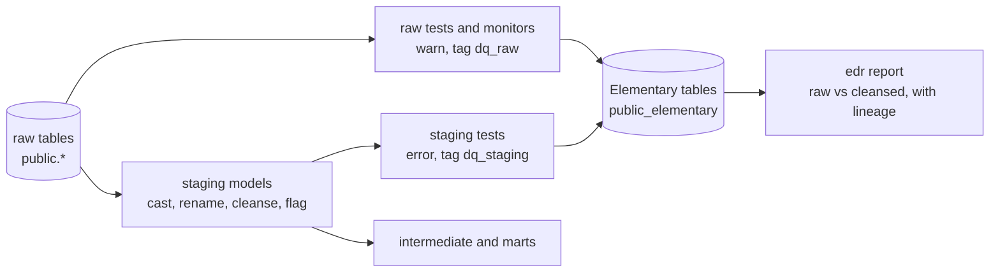

---
tags:
  - project/enpal
  - type/plan
---

# Elementary rollout: data quality tests and monitoring

Plan for monitoring the data quality issues in [[findings]] (main list: `analyses/00_data_quality_issues.sql`) with **Elementary**, the open-source dbt package plus CLI. Status (2026-10-23): phases 1 and 2 done on branch `feature/elementary` (not committed); report served on localhost with `bash scripts/dq_report.sh` (http://localhost:8081/elementary_report.html). Phase 3 waits for the models.

## Split of tools

| Tool | Used for | Not used for |
|---|---|---|
| dbt tests (generic, `dbt_utils`, singular) | the checks themselves: keys, domains, relationships, business rules, report grain | |
| Elementary dbt package | stores every test result and run in tables in schema `public_elementary`; adds anomaly and schema-change tests | |
| Elementary CLI `edr` | the data quality report (HTML: test results over time, failed rows, lineage) and, in production, alerts | |
| Lightdash | **final dashboards only**: `rep_sales_funnel_monthly` | quality checks; the data quality charts built during exploration are retired from Lightdash |

Why Elementary, not Lightdash, for quality: it reads dbt's own test results (no second set of SQL to maintain), keeps the history of each test, shows failed rows and lineage, and knows owners and tags from the YAML. A BI tool would only chart counts that someone recomputes by hand.

## Versions

- Package `elementary-data/elementary` 0.26.1 (dbt `>=1.0, <3.0`; project runs dbt-core 1.12.5 on Postgres, supported).
- CLI `elementary-data[postgres]` 0.26.1 (Python 3.10 to 3.13), installed in its **own venv** `~/.venvs/edr`, so it cannot upgrade the project's dbt (1.10.23).

## How the issues become tests

Two kinds of check, because the issues are of two kinds:

1. **Known defects, pinned to today's count.** On the one-time load the count is fixed, so the test warns at today's count and fails above it: `warn_if: ">0"`, `error_if: ">N"` with N the measured count. A known issue stays visible (warn) without breaking the build; a new instance fails it.
2. **Rates that move with new data, as anomaly monitors.** In production the counts grow with the deals, so a pinned number would fail every week. A rate is put on a model as a boolean flag (for example `skips_a_stage` on `int_pipedrive__deals`) and Elementary's `column_anomalies` (`count_true`) watches it per month of `created_at`: it fails when a month leaves the range learnt from the earlier months.

Severity follows [[findings]]: **error** when our own pipeline would be wrong, **warn** for a known upstream defect handled in staging, **info** (documented, no test) when nothing can be checked.

Every test gets `meta` with the issue id, the category (process or data) and the owner, and `tags: [data_quality]`, so the Elementary report can be filtered by issue and owner.

| Issue | Category | Test | Where | Severity |
|---|---|---|---|---|
| D1 stages skipped (84%) | process | flag `skips_a_stage`, `column_anomalies: count_true` per month | `int_pipedrive__deals` | warn |
| D2 after-sale without Closing (683) | process | flag `is_after_sale_without_closing`, `column_anomalies: count_true` | `int_pipedrive__deals` | warn |
| D3 two lifecycles (5 deals) | process | existing `unique_add_time_per_deal`, `error_if: ">5"`; flag `has_two_lifecycles` | source `deal_changes`; `int_pipedrive__deals` | warn |
| D4 lost reason on every deal | process | `dimension_anomalies` on `lost_reason_id`, time `created_at` | `int_pipedrive__deals` | warn |
| D5 changes at the creation clock time (99.8%) | data | singular test: share above 50% signals generated or backfilled history | `stg_pipedrive__deal_changes` | warn |
| D6 mixed types in `new_value` | data | existing `accepted_values` per key; `not_null` on the typed columns after the cast | source; staging | error |
| A1 repeated `activity_id` (11) | data | existing `unique`, `error_if: ">11"`; `unique` + `not_null` on `activity_id` after deduplication | source; `stg_pipedrive__activity` | warn; error |
| A2 activities not linked to deals (8 of 4,579 match) | process | existing `relationships` on `deal_id`, pinned to today's failures | source `activity` | warn |
| A3 after-close calls before the first Closing (157) | process | singular test, `error_if: ">157"` | `int_pipedrive__sales_calls` | warn |
| A4 done flag ~50% for every type | process | `dimension_anomalies` on `activity_type` with `is_done`, time `due_at` | `stg_pipedrive__activity` | warn |
| T1 inactive type in use; `active` as text | data | `accepted_values ['Yes', 'No']` on source; singular test: activities of inactive types, `error_if: ">1133"` | source; staging | error; warn |
| U1 shared emails (4) | data | `unique` on `email`, `error_if: ">4"` | `stg_pipedrive__users` | warn |
| U2 1,347 owners for 1,995 deals | data | none, documented | | info |
| S1 "Qualified lead" vs "Qualified Lead" | data | singular test: stage name differs from field label, `error_if: ">1"` | staging | warn |
| X1 tables end on different dates | export | singular test: last dates of `deal_changes`, `activity`, `users` more than 31 days apart | staging | warn |

General monitors, independent of the known issues:

| Check | Test | Where | Severity |
|---|---|---|---|
| A column added, dropped or retyped upstream | `elementary.schema_changes_from_baseline` (columns and types declared in the sources YAML) | all six sources | error |
| A double or partial load | existing full-row `unique_combination_of_columns`; `elementary.volume_anomalies`, time `change_time` / `due_to`, weekly buckets | `deal_changes`, `activity` | error; warn |
| A stage or event key that stops arriving | `elementary.dimension_anomalies` on `changed_field_key` | `deal_changes` | warn |
| Report grain and reconciliation | `unique_combination_of_columns [month, funnel_step]`, `deals_count >= 0`, totals per step equal the targets in [[model_plan]] | `rep_sales_funnel_monthly` | error |
| A funnel step that drops out in a month | `elementary.dimension_anomalies` on `funnel_step`, time `month` | `rep_sales_funnel_monthly` | warn |
| Freshness | `elementary.event_freshness_anomalies` in production only; the static export would always be stale | sources | off locally |

The exploration probes in `tests/exploration/` that confirmed a finding move into these model tests; the others are deleted.

## Two layers: monitor the raw data, cleanse in staging, test the cleansed data

The same issue is checked twice, with a different question each time:

| Layer | Question | Tests | Severity | Who acts on a finding |
|---|---|---|---|---|
| Raw (dbt sources) | How bad is the source today, and is it getting worse? | known-issue tests and Elementary monitors on `source('postgres_public', ...)` | **warn**: the source is described, never blocks the build | the process owner (CRM data entry, export) |
| Staging (cleansed) | Did our cleansing work, and does the data keep the promise the models rely on? | key, type, domain and reconciliation tests on `stg_pipedrive__*` | **error**: a failure means our pipeline is wrong | the data team |



### Raw layer: monitor

- All raw tests sit on the sources in `_pipedrive__sources.yml`, with `config: {severity: warn, tags: [dq_raw]}` and `meta: {issue: A1, category: data, owner: ...}`.
- Known issues: one test per issue; its failure count is the size of the issue, stored by Elementary on every run, so the report shows the trend per issue.
- Elementary monitors on the sources: `schema_changes_from_baseline`, `volume_anomalies` (time `change_time` / `due_to`), `dimension_anomalies` on `changed_field_key` and activity `type`.
- Nothing is changed in the raw tables.

### Staging layer: cleanse

One staging model per raw table. The cleansing of each issue follows the exploration, business case and assumption in [[cleansing_proposals]] and waits for the owner's decision there. Staging never drops a row whose meaning is unclear: it adds a unique key and a flag. The only rows it removes are exact copies, through a defined deduplication on a surrogate key (decided), not a blanket `distinct`.

| Issue | Proposed cleansing in staging |
|---|---|
| DUP-1 full-row duplicates | **decided:** `deal_change_key` over all columns of `deal_changes` (`dbt_utils.generate_surrogate_key`), keep the first row per key; 0 removed today |
| DUP-2 / D3 two deals under one `deal_id` | lifecycle number per event (by the clock time of its creation), `deal_key`; flag `has_shared_deal_id` (split decided in intermediate) |
| D6 mixed types | one typed column per event key (`stage_id`, `owner_id`, `created_at`, `lost_reason_id`), cast after filtering on the key |
| DUP-3 / A1 repeated `activity_id` | **decided:** `activity_id` is the primary key; keep the row with the latest `due_to` per id; 11 rows removed |
| A2 activities without a known deal | flag `has_known_deal` |
| T1 `active` as text | `is_active` boolean from 'Yes' / 'No' |
| DUP-5 / U1 shared emails | `lower(trim(email))`; flag `has_shared_email` |
| S1 stage spelling | `stage_name` from the task's step names (seed); source name kept as `source_stage_name` |

Not cleansed in staging, because they are business rules: skipped stages (D1, backfill in intermediate), two lifecycles (D3, counted once in intermediate), lost reason (D4), generated timing (D5), call timing and done flag (A3, A4), export dates (X1, report window).

### Staging layer: test the cleansed data

Tests on the staging models, `config: {severity: error, tags: [dq_staging]}`. They should pass; a failure means the cleansing broke or a new kind of defect arrived.

| Issue | Test after cleansing |
|---|---|
| Double load | `unique` + `not_null` on `deal_change_key`; `unique_combination_of_columns` on (`deal_key`, `changed_field_key`, `change_time`) of `stg_pipedrive__deal_changes` (no two values for one field at one time) |
| D6 | `not_null` on each typed column where its key matches; `accepted_values` 1 to 9 on `stage_id` |
| A1 | `unique` + `not_null` on `activity_id` (after deduplication) |
| T1 | `not_null` on `is_active` |
| U1 | `unique` on `user_id` (email deliberately not tested as a key) |
| S1 | `accepted_values` on `stage_name` (the 9 task names) |
| Reconciliation | singular test per fact: raw rows - removed rows = staging rows (`deal_changes`: 0 removed; `activity`: 11 removed today, warn on the raw side) |

### How Elementary is configured for the two layers

- Tags and severity per layer, set in the YAML (`config:` on each test) or once per folder in `dbt_project.yml` under `data_tests:` if the sources YAML moves to its own folder (to verify that folder config applies to source tests).
- `dbt build` runs in DAG order: raw tests, then the staging models, then the staging tests, then downstream. Warn tests on the raw data do not stop the build; an error test on staging skips everything downstream of the failing model.
- Elementary stores both layers in the same `elementary_test_results` table; `edr report` shows them side by side with lineage, so each issue reads as "raw: N rows, staging: 0". `edr report --select` accepts only invocation selectors (checked in the CLI code, 0.26.1), so the layers are separated with the tag filter inside the report's Test results table. Layout of the report: [[elementary_report_layout]].
- In production `edr monitor` routes the alerts by `meta`: raw warnings to the process owner, staging errors to the data team.

## How I will do it

### Phase 1: install and configure (now, sources only)

1. New branch `feature/elementary` from the solution branch, PR to the fork only.
2. `packages.yml`: add `elementary-data/elementary` 0.26.1; `dbt deps`.
3. `dbt_project.yml`: give the package its own schema, so its tables stay out of the analytics schema:
   ```yaml
   models:
     elementary:
       +schema: elementary
   ```
4. `dbt run --select elementary`: creates the Elementary tables (`elementary_test_results`, `dbt_run_results`, `dbt_models`, ...) in `public_elementary`. From then on the package's `on-run-end` hook writes every run and test result there.
5. CLI in the venv: `pip install 'elementary-data[postgres]==0.26.1'`; add an `elementary` profile to the repo's `profiles.yml` (same local Postgres, schema `public_elementary`, the task's admin/admin), generated with `dbt run-operation elementary.generate_elementary_cli_profile`.
6. `.gitignore`: `edr_target/`.
7. Check: `dbt test --select source:postgres_public`, then `select test_name, status, failures from public_elementary.elementary_test_results` returns one row per probe, with the counts in the analysis files.

### Phase 2: sources (now)

1. Add `meta`, `tags`, the pinned thresholds and the source-level rows of the tables above to `_pipedrive__sources.yml`.
2. Declare column types for `schema_changes_from_baseline`; add volume and dimension monitors on `deal_changes` and `activity`.
3. Anomaly tests on a one-time load: the history is 2024-01 to 2025-03 and today is 2026, so the run date is set inside the data range with the Elementary var `custom_run_started_at` (ISO date; confirmed in the package source) and `training_period` covers the earlier months, in weekly buckets (at least 7 training buckets are needed). Without this, every bucket is "old" and nothing is tested.
4. `edr report --profiles-dir .` writes `edr_target/elementary_report.html`; open it and compare each failure count with `analyses/00_data_quality_issues.sql`. A difference means the test or the analysis is wrong.

### Phase 3: models (after the models exist)

The test YAML of each model and the singular tests are added as the models are written; the flag columns (D1, D2, D3) are a proposal for `int_pipedrive__deals`. Then `dbt build` runs models and tests together, and the report shows each issue on the model it affects, with lineage to the source.

### Phase 4: dashboards and production

- Lightdash: only the funnel dashboard on `rep_sales_funnel_monthly`; the exploration charts on data quality are removed from the Lightdash project (with the owner's go).
- Production, for the README (not built here): `dbt build` then `edr monitor` sends Slack alerts for failed tests to the owner in `meta`; `edr report` (or `edr send-report` to a bucket) publishes the report after each run; freshness monitors switched on; pinned thresholds replaced by the anomaly monitors as new data arrives.

## Who does what

| Step | Who |
|---|---|
| Package, schema, CLI, profile, `.gitignore` (phase 1) | Claude, reviewed by the owner |
| Source tests and monitors (phase 2) | Claude drafts, owner reviews |
| Model tests, flag columns, singular tests (phase 3) | owner writes, Claude reviews |
| Retire the Lightdash data quality charts | owner decides |

## Decisions

- **Own branch** `feature/elementary`, merged into the solution branch (owner, 2026-10-23).
- **Known issues only warn** (owner, 2026-10-23): the tests above keep `severity: warn` and drop the `error_if` thresholds; a new instance shows as a higher warn count in the report, not a failed build. `error` stays only for our own pipeline (D6 typed columns, `activity_id` after deduplication, `deal_change_key`, `accepted_values` on `active`, schema changes, double load, report grain and reconciliation).
- `metric_stability` not in the first iteration (owner, 2026-10-23).
- Owner role names in `meta.owner` left open (owner, 2026-10-23).
- Open: flag columns D1 to D3 on `int_pipedrive__deals`.

## As built (2026-10-23)

- `packages.yml`: `elementary-data/elementary` 0.26.1. `dbt_project.yml`: `elementary: +schema: elementary`; `data_tests:` folder config: `models/staging/pipedrive/sources/` and `tests/data_quality/` warn with tag `dq_raw` (verified: folder config reaches source tests once the sources YAML has its own folder), `tests/exploration/` warn with tag `dq_exploration`.
- `models/staging/pipedrive/sources/_pipedrive__sources.yml` (moved): every test named by issue id, with description (count on 2026-10-23), kind and family tags, `meta.issue`, `owner`, `quality_dimension`; column `data_type`s for `schema_changes_from_baseline` (6 sources, error); weekly volume, freshness and dimension monitors on `deal_changes` and `activity`.
- `tests/data_quality/`: singular tests d5, a3, t1, s1, x1 (description in `meta.description`).
- `profiles.yml`: profile `elementary` (schema `public_elementary`); `.gitignore`: `edr_target/`.
- `scripts/dq_report.sh`: `dbt run -s elementary`, `dbt test` with `custom_run_started_at: 2025-03-10T00:00:00`, `edr report`, serves `edr_target/` on 127.0.0.1:8081.

Result: 63 tests, 47 pass, 16 warn, 0 error. Known-issue counts equal `analyses/00_data_quality_issues.sql`: A1 11, A2 4,571, A3 157, D3 5 and 5, D5 15,368, S1 1, T1 1,133, U1 4, X1 2. Monitors: activity volume 4 empty weeks; dimension monitors warn on activity types (all 0 after 2024-09-13) and on `deal_changes` keys (`add_time` 0: **no deal created after 2024-09-13**, new finding, see X1 in [[cleansing_proposals]]); freshness on activity passes (gaps also in training); schema baselines pass.

Lessons:
- The run date must be a **Monday 00:00**: weekly buckets start on Mondays; a Wednesday run date cut new buckets overlapping the stored ones and doubled the anomalies on every rerun.
- `dbt run -s elementary --full-refresh` does not reset `data_monitoring_metrics`; add `--vars '{elementary_full_refresh: true}'`.
- The first run after a reset under-reports dimension anomalies (zero weeks per value not stored yet); from the second run the counts are stable.
- For Elementary's own tests the report shows the test type ("dimension_anomalies"), not the custom `name`; the issue id is in the description.

## Snowflake target (2026-10-24)

The project also runs on the Snowflake trial **UE17459** (the latest; created 2026-10-18).
- **Objects:** role `ENPAL_DBT_ROLE` (granted to the CLI key-pair user, her Snowsight user and SYSADMIN), warehouse `ENPAL_WH` (XS, suspends after 60 s), database `ENPAL_DB`. Raw tables are in `ENPAL_DB.RAW`, dbt output in `PUBLIC_*` schemas, Elementary in `PUBLIC_ELEMENTARY`.
- **Load:** `scripts/snowflake_load.sql` (same DDL as init.sql; `fields.field_value_options` is a VARIANT). It replaces the tables, so a rerun never appends. Row counts equal Postgres: 4 / 4,579 / 15,406 / 4 / 9 / 1,787.
- **Login:** Snowsight SSO is Google OIDC; the CLI's `externalbrowser` needs SAML, so dbt and edr use key-pair auth. Account, user and key path are in `~/.snowflake/enpal.env` (template `scripts/snowflake_env.example`), not in the public repo.
- **Venvs:** `~/.venvs/enpal_sf` holds dbt-core 1.10.23 + dbt-snowflake 1.10.8. The Postgres venv is unchanged; the edr venv got the Snowflake extra.
- **Portability changes:**
  - Source database and schema, and the declared column types, come from `vars` in dbt_project.yml (`raw_schema`, `raw_types`), because project macros are not available in source YAML. Elementary's schema baselines need the warehouse's own type names (NUMBER, TEXT, TIMESTAMP_NTZ, VARIANT).
  - D5 uses `cast(... as time)`, X1 uses `dbt.dateadd`, S1 has a Snowflake branch (`lateral flatten`), and the explore_first_stage_is_1 probe uses `row_number` (arrays start at 1 on Postgres and at 0 on Snowflake).
- **Run:** `bash scripts/dq_report.sh 8082 snowflake` serves http://localhost:8082/elementary_report_snowflake.html.
- **Result:** the same as on Postgres: 63 tests, 47 pass, 16 warn, 0 errors, with every known-issue and monitor count equal.
- **Not moved:** the `analyses/` files are still Postgres SQL (jsonb, `::` casts), and the Lightdash project still points at Postgres.

## Raw-data metadata and key tests (2026-10-24)

Following the dbt-labs agent skills (`using-dbt-for-analytics-engineering`: writing-data-tests and writing-documentation; Tier 1 = PK unique + not_null and FK relationships on every key), everything the exploratory analysis found about the raw tables is now in dbt.
- **Descriptions:** every table and all 24 columns have one, taken from data_dictionary.md, logical_model.md and the findings. They say why, not what: grain, edge cases, issue ids.
- **Table `config.meta`:** `table_kind` (fact / dictionary), `grain`, `primary_key`, `natural_key`, `foreign_keys`, `row_count`, `covers` (date range).
- **Column `config.meta`:** `key` (primary / natural / foreign), `references`, `issue`.
- **New tests:**

| Test | Kind | Count on 2026-10-24 |
|---|---|---|
| `pk_grain__deal_changes` (deal_id, changed_field_key, change_time) | PK check | 0 |
| unique + not_null on `fields.id` | PK check | 0 |
| `fk_field_key_in_fields__deal_changes` | FK check | 0 |
| `fk_stage_events_in_stages` (new_value of stage_id) | FK check, singular (needs a cast) | 0 |
| `fk_owner_events_in_users` (new_value of user_id) | FK check, singular | 0 |
| `change_time_plausible_range__deal_changes` | range check | 0 |
| `first_stage_is_1`, `stage_move_before_creation`, `stage_moves_at_same_time`, `deal_has_creation_owner_and_stage` | sequence / completeness checks | 0 |
| `d1_deals_with_skipped_stages` | known issue D1 | 1,684 |
| `d2_after_sale_without_closing` | known issue D2 | 683 |
| `d3_lost_reason_before_last_stage` | known issue D3 (all 4 in the two-lifecycle deals) | 4 |
| `d4_lost_reason_on_deals_past_closing` | known issue D4 | 1,424 |

- **Probes:** the 7 in `tests/exploration/` were promoted (renamed, rewritten in house style) and the folder deleted, together with its `dq_exploration` config. `explore_stage_moves_not_forward_by_one` (2,512 moves) became D1 counted per deal (1,684, as in 00_data_quality_issues.sql).
- **Casts:** `new_value` is cast with `dbt.safe_cast` after filtering on the key (try_cast on Snowflake, which may evaluate the cast before the filter).
- **U2** (owner shape) is in the `users` description, not a test: there is no threshold to test.
- **Result on both targets:** 71 tests, 53 pass, 18 warn, 0 errors, every count equal on Postgres and Snowflake.
- **Housekeeping:** `models/test_model.sql` removed; its built tables (`public_pipedrive_analytics.test_model` on Postgres, `PUBLIC_PIPEDRIVE_ANALYTICS.TEST_MODEL` on Snowflake) are left in place. `requirements.txt`, `requirements-snowflake.txt` and `requirements-elementary.txt` added; the Postgres image is pinned to 18.6.
