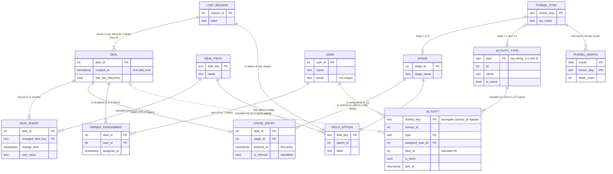

---
tags:
  - project/enpal
  - type/model
---

# Logical model

The business entities behind the six raw tables and how they relate, **before** any dbt model is designed. The physical layers (staging, intermediate, marts) in [[model_plan]] implement this model. Cardinalities were measured on the loaded data (min to max per entity); "intended" marks a relationship the business expects but the export does not support.

## Relationships

| Relationship | Type | Measured | Consequence for the model |
|---|---|---|---|
| Deal : deal event | 1 to many | 4 to 17 events per deal | A deal table must be derived (`int_pipedrive__deals`); there is no deals table |
| Deal field : deal event | 1 to many | 4 keys, all used | Typed per-key models in staging (stage, owner, creation, lost reason) |
| Deal : stage entry | 1 to many | 1 to 8 stages per deal (no deal enters all 9) | Grain deal x stage, first entry; backfill adds inferred entries |
| Stage : stage entry | 1 to many | 324 to 1,995 deals per stage | `relationships` test from entries to stages |
| Stage : field option | 1 to 1 | 9 labels, one spelling differs | Report uses the task's names |
| Deal : owner assignment | 1 to many | 1 to 3 per deal | Owner over time needs the events; `users` is current state |
| User : owner assignment | 1 to many (optional) | 1,347 owners, 1 to 7 deals each | Not needed for the report |
| Lost reason : deal | 1 to many | 377 to 422 deals per reason; 5 deals carry 2 | Not a deal outcome; not used for the funnel |
| Activity type : activity | 1 to many | 1,124 to 1,177 per type; type key is 1 to 1 with the id | Join on the key string `type` |
| User : activity | 1 to many (optional) | 1,650 users, 1 to 11 each | `relationships` test |
| Deal : activity | intended 1 to many, not supported | 8 of 4,579 match | Calls counted by due month, not per funnel deal |
| Funnel step : stage / activity type | 1 to 1 (one or the other) | 9 stage steps, 2 call steps | `dim_funnel_step` seed with `source_type` |
| Funnel step : funnel month | 1 to many | one row per month and step | Report grain (`month`, `funnel_step`), unique |
