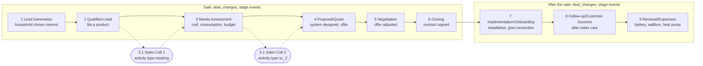

---
tags:
  - project/enpal
  - type/assumption
---

# Assumption: how a deal goes through Enpal's sale

**This is my assumption** of how the deals look like in Enpal's sales process, built from the company description, the CRM data and the Pipedrive vocabulary. It is not confirmed by Enpal and has to be checked with the KPI owner (head of sales or revenue operations) before the funnel definitions are final. Context: [[business_context]]; field meanings: [[crm_field_definitions]].

## The sale behind the data

Selling a solar system to a household is a long, consultative sale: a lead shows interest, a sales rep qualifies it, consultation calls follow, the roof, consumption and budget are assessed, a system is designed and offered (rental or purchase), the offer is negotiated and signed, then the system is installed and connected, and after-sales follows (service, add-ons such as storage, a wallbox, a heat pump or an electricity contract).

Pipedrive, the CRM in the export, records this as **deals** moving through the **stages** of a **pipeline**, owned by **users** (sales staff), with **activities** (calls, meetings) planned against them.

Solid arrows: stage events in `deal_changes` (first entry per stage counts). Dotted: consultation calls from `activity`, which in this export cannot be linked to the deals (only 8 of 4,579 deal ids match).

## The funnel: each KPI, its business meaning and where it is in the data

The step names are the task's. The business meaning is **my interpretation, to confirm with Enpal**.

| Step | KPI | Business meaning (interpretation) | Data | Candidate rule |
|---|---|---|---|---|
| 1 | Lead Generation | a household shows interest; a deal is created | `deal_changes` | creation (`add_time` event) **or** first entry into stage 1 (open decision) |
| 2 | Qualified Lead | the lead fits a product and is worth a consultation | `deal_changes`, `stages` | first entry into stage 2 |
| 2.1 | Sales Call 1 | first consultation call | `activity`, `activity_types` | activity type `meeting` (name Sales Call 1), done |
| 3 | Needs Assessment | roof, consumption and budget assessed | `deal_changes` | first entry into stage 3 |
| 3.1 | Sales Call 2 | second consultation call | `activity` | activity type `sc_2` (Sales Call 2), done |
| 4 | Proposal/Quote Preparation | system designed, offer (rental or purchase) prepared | `deal_changes` | first entry into stage 4 |
| 5 | Negotiation | offer discussed and adjusted | `deal_changes` | first entry into stage 5 |
| 6 | Closing | contract signed | `deal_changes` | first entry into stage 6 |
| 7 | Implementation/Onboarding | installation and grid connection | `deal_changes` | first entry into stage 7 |
| 8 | Follow-up/Customer Success | after-sales care | `deal_changes` | first entry into stage 8 |
| 9 | Renewal/Expansion | add-ons: storage, wallbox, heat pump, electricity | `deal_changes` | first entry into stage 9 |

Not funnel steps: the activity types Follow Up Call and After Close Call.

## Where the data contradicts the assumption

- 84% of deals skip at least one stage, and 683 of 1,081 deals in stages 7 to 9 never recorded Closing: reps do not move deals step by step.
- Sales calls are flat from the first month and 157 After Close Calls are due before the first deal reached Closing: the activities do not follow these deals.
- Every deal carries a lost reason, also deals that reached Renewal/Expansion.

These are listed with their SQL in [[deal_history_and_questions_for_enpal]] and [[findings]].
